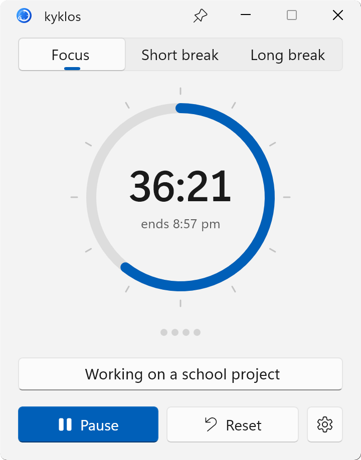

# kyklos for Windows

kyklos (KEE-klos, Greek for both *circle* and *cycle*) is a free, minimal Pomodoro timer for Windows 11, in its own
window and in the system tray. It's designed with ADHD in mind, to keep a wandering mind on one thing at a time.

It's the same app as [kyklos for Mac](https://github.com/yiorgos-p/kyklos-timer), made for Windows.

<p align="center">
  <picture>
    <source media="(prefers-color-scheme: dark)" srcset=".github/screenshot-dark.png">
    
  </picture>
</p>

## Designed for ADHD

- **Time you can see.** The time left is a shrinking arc, not just numbers, with the time the session ends below it,
  so time doesn't quietly slip away.
- **One thing at a time.** You write down what you're working on, and it stays in view in the window, the mini timer
  and the tray, so a quick detour is easy to notice.
- **Hard to miss, easy to restart.** If you're deep in something when time runs out, the alarm rings again every
  minute and the timer shows how far over you've gone. The next phase is one click away.
- **No distractions.** No accounts, streaks or charts to keep up with. Zen mode and Minimal mode strip it down
  further, and there are low, soft alarm sounds for sensitive ears.

## Features

- Focus, Short break and Long break, with a long break after every 4 focus sessions (2 to 8, your choice)
- When time is up, the timer counts the overtime and offers to start the next phase with one click
- A "What are you working on?" line, shown in the window, in the mini timer and next to the time in the tray icon's
  tooltip
- A 60-minute dial: the coloured arc is the time left, so 25 minutes always looks like 25 minutes, plus the time it will end
- Drag the dial to set the length, scroll over it, use the arrow keys, or click the time and type it
- Today's finished focus sessions, shown as dots, with a button to reset them
- Accurate to the system clock: keeps counting through sleep and never drifts
- A notification and an alarm when time is up, with the alarm ringing again every minute for up to 10 minutes
- A choice of alarm sounds, including low, soft ones, or your own: any audio file up to 30 seconds
- A global shortcut to start or pause from any app: Ctrl+Alt+K, or one you pick
- A tray icon that empties as time runs out: green, then yellow with a third left, red near the end. Click it for the
  timer, or right-click it for a menu
- The session's progress on the taskbar button, so you can see it with the window minimised
- Optional mouse mode: click the dial to start or pause, and triple-click it to reset
- Optional Zen mode that hides the phase switcher while the timer is running
- Optional Minimal mode: a small floating timer with the time, the task and one button, shown during a session or all
  the time
- A window that can stay on top of other windows
- Light and dark, following Windows or set by hand, in Windows 11's Mica, with Focus in your accent colour
- Start with Windows, and kyklos can stay out of the taskbar and live in the tray
- A native Windows 11 app, built with WinUI 3 and light on resources: about 45 MB of memory in Task Manager and well
  under 1% of the CPU
- No ads and no data collection; kyklos never connects to the internet

## Download

kyklos needs Windows 11. It's made and tested on Windows 11 on an x64 PC; reports from Arm PCs are welcome.

1. Download `kyklos-windows-x64.zip` from the [latest release](../../releases/latest), or `kyklos-windows-arm64.zip` if
   your PC has an Arm processor (Settings → System → About says which, under System type). Right-click the zip and
   choose Extract All.
2. Move the `kyklos` folder somewhere it can stay, open it, and run `kyklos.exe`.
3. Windows will say "Windows protected your PC", because the app isn't signed (that takes a paid certificate). Click
   **More info**, then **Run anyway**.

You only need to do this once. To find kyklos again, right-click `kyklos.exe` and choose Pin to Start, or turn on Start
with Windows in its settings.

## Build from source

You need the [.NET 10 SDK](https://dotnet.microsoft.com/download/dotnet/10.0) on Windows. To run kyklos:

```sh
dotnet run --project kyklos
```

To build a release, as in the zips (use `win-arm64` for Arm):

```sh
dotnet publish kyklos -c Release -r win-x64
```

The app ends up in `kyklos/bin/Release/net10.0-windows10.0.26100.0/win-x64/publish`. The timer's tests run with
`dotnet test --project kyklos.Tests/kyklos.Tests.csproj`.

## Dependencies

- [Windows App SDK](https://github.com/microsoft/WindowsAppSDK) (WinUI 3)
- [Windows Community Toolkit](https://github.com/CommunityToolkit/Windows): Segmented and SettingsControls
- [C#/Win32](https://github.com/microsoft/CsWin32)
- Three icons from [Fluent UI System Icons](https://github.com/microsoft/fluentui-system-icons)

## Support

I made kyklos for my own wandering mind, and it's free and will stay free. If it helps yours too, please consider
[buying me a coffee on Ko-fi](https://ko-fi.com/yiorgosp).

## License

kyklos is licensed under the GNU General Public License v3.0. Its alarm sounds are kyklos's own, synthesized from sine
waves. The components it's built on, and their licences, are listed in [THIRD-PARTY-NOTICES.md](THIRD-PARTY-NOTICES.md).
